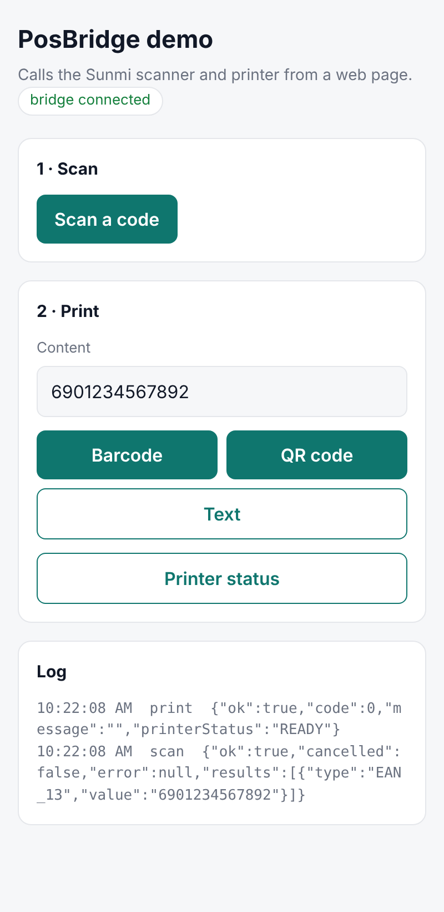
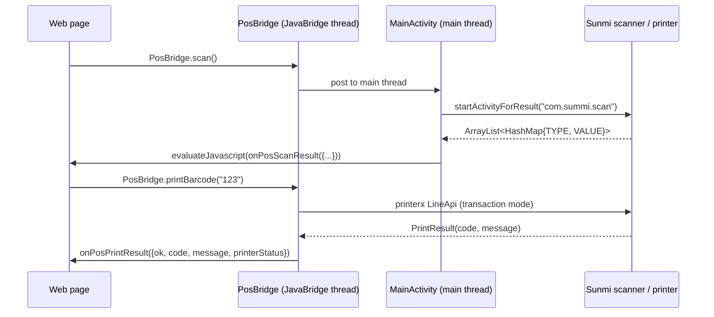

<p align="center"></p>

<h1 align="center">Sunmi WebView Bridge</h1>

<p align="center">
  Run any web app full-screen on a Sunmi POS terminal and let it use the device's
  <b>built-in scanner and receipt printer</b> from JavaScript.
</p>

<p align="center">
  <a href="README.zh-CN.md">中文说明</a> ·
  <a href="#javascript-api">JavaScript API</a> ·
  <a href="#build">Build</a>
</p>

---

Many stores already run their back-office as a web app (inventory, labelling, order lookup).
On a Sunmi handheld or desktop terminal that web app can't reach the hardware. This app wraps
it in a WebView and exposes a small, documented bridge:

```js
PosBridge.scan();                          // opens Sunmi's scanner
window.onPosScanResult = r => console.log(r.results[0].value);

PosBridge.printBarcode('SKU-2026-0001');   // barcode + large readable value underneath
PosBridge.printQrCode('https://example.com');
PosBridge.printText('Thank you!', 28, true, 'center');
window.onPosPrintResult = r => r.ok || alert(r.message);
```

<p align="center"></p>

## Features

- **Setup screen, no rebuild needed**: the operator enters the start URL once (plus an optional home URL); later launches open it directly.
- **Scanner**: launches Sunmi's scanner app with 20+ symbologies enabled (QR, Data Matrix, PDF417, EAN/UPC, Code 128/39/93, ...).
- **Printer**: barcodes, QR codes and styled text through Sunmi's `printerx` SDK, as one transaction with a single result callback.
- **Safe callbacks**: results are sent as escaped JSON through `evaluateJavascript`, so a scanned value can never execute as code.
- **Works off-device**: on emulators and ordinary phones every call returns a clear "not available" result, so the web side can be built anywhere. Open the built-in demo page to try every method.
- **Backward compatible**: pages written for the first version (`android.scan()`, `android.print(type, content)`, `scanCallBack`, `printCallBack`) keep working.
- **Store-ready details**: offline screen with retry, cache reset when the URL changes (avoids blank screens after an SPA deploy), double-back to exit, English and Simplified Chinese UI.

## How it works



| Path | Responsibility |
|---|---|
| `bridge/PosBridge.kt` | `@JavascriptInterface` methods; hops to the main thread; sends callbacks |
| `bridge/Json.kt`, `bridge/JsCallback.kt` | JSON escaping and callback scripts (unit-tested) |
| `printer/SunmiPrinter.kt` | `printerx` wrapper; graceful fallback when no printer |
| `printer/PrintCommand.kt` | Print jobs and results, independent of the SDK (unit-tested) |
| `scanner/` | Scanner intent and result parsing (unit-tested) |
| `config/` | URL validation and persisted settings |

## JavaScript API

The bridge is available as `window.PosBridge`. Check `window.PosBridge && PosBridge.isReady()` before using it.

| Method | Result callback |
|---|---|
| `scan()` | `onPosScanResult(result)` |
| `printBarcode(content)` | `onPosPrintResult(result)` |
| `printQrCode(content)` | `onPosPrintResult(result)` |
| `printText(content, size, bold, align)`: size 12–64, align `"left"`/`"center"`/`"right"` | `onPosPrintResult(result)` |
| `getPrinterStatus()`: returns a JSON string `{"available": true, "status": "READY"}` | none (synchronous) |

```ts
type ScanResult  = { ok: boolean; cancelled: boolean; error: string | null;
                     results: { type: string; value: string }[] };
type PrintResult = { ok: boolean; code: number; message: string; printerStatus: string | null };
// code: 0 = printed, -1 = no printer on this device, -2 = SDK error, -3 = nothing to print,
//       other values come from the printer (e.g. out of paper).
```

Define callbacks on `window` (in ES modules, assign them explicitly: `window.onPosScanResult = ...`).

<details>
<summary>Legacy API (first version)</summary>

| Call | Behaviour |
|---|---|
| `android.scan()` | Same as `PosBridge.scan()`; also calls `scanCallBack("[{TYPE=..., VALUE=...}]")` |
| `android.print("QR Code", content)` | Prints a QR code; any other non-empty type prints a barcode |
| `printCallBack(status)` | Called after a legacy print with the printer status |

</details>

## Build

Requirements: JDK 17, Android SDK 34.

```bash
./gradlew testDebugUnitTest   # JVM unit tests
./gradlew assembleDebug       # app/build/outputs/apk/debug/
```

Every push runs the same steps on GitHub Actions and attaches the debug APK to the run.

**Release signing**: copy `keystore.properties.example` to `keystore.properties` (git-ignored), fill in your keystore,
then run `./gradlew assembleRelease`. Nothing secret lives in the repository.

## Device notes

- Needs a Sunmi device with a built-in printer and Sunmi's scanner app (`com.sunmi.sunmiqrcodescanner`). The setup screen shows whether both were found.
- Cleartext HTTP is allowed because store back-offices are often served on the LAN (e.g. `http://192.168.1.20:8080`). Set `cleartextTrafficPermitted="false"` in `res/xml/network_security_config.xml` if you only use HTTPS.
- The bridge is exposed to every page loaded in the WebView. Only point the app at web apps you trust.

## Background

I first built this in 2023 as a freelance project for Sunmi POS terminals. This repository is a
clean rewrite for open source: client-specific URLs, branding and signing data were removed, and the
code was restructured with tests, a documented API and CI.

## License

[MIT](LICENSE) © 2023-2026 Yihan Qiu
